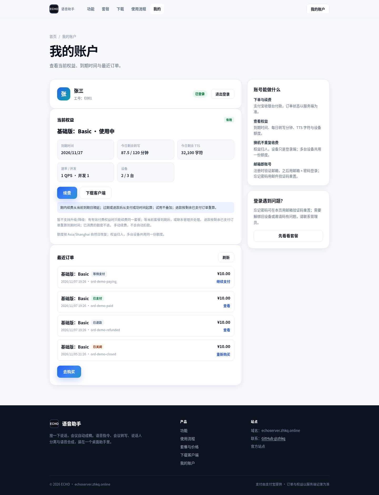
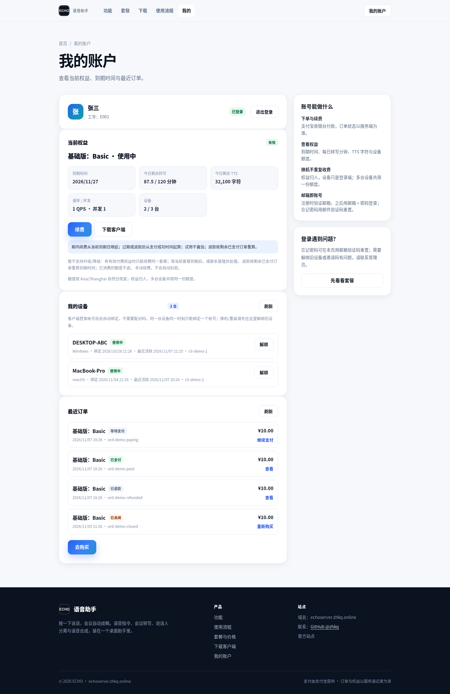
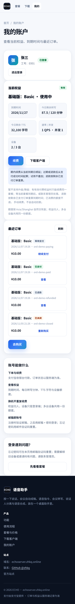
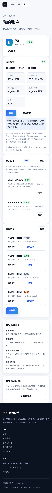

# 账户页设备列表 · Before/After 截图（issue #23）

对应 `POST /v1/account/devices/bind` 与账户页「我的设备」。

- **Before**：`c09884b`（`integration/billing-vibepay` 基线；账户页只有权益/订单，没有设备列表）
- **After**：本分支（账户页新增设备名、平台、绑定时间、最近活跃与解绑）
- 同一份 mock 账号/权益/设备数据、同一视口（桌面 1440×900，移动 375×812）、浅色、中文。
- 设备是 mock 数据（`cli-demo-1` / `cli-demo-2`），不是真实账号，也不含凭据。

| 场景 | 截图 |
|---|---|
| before-account-devices |  |
| after-account-devices |  |
| before-account-devices-mobile |  |
| after-account-devices-mobile |  |

## 复采

```bash
python scripts/capture-account-device-evidence.py
```

依赖 Python + `playwright` + 本机 Chrome。
