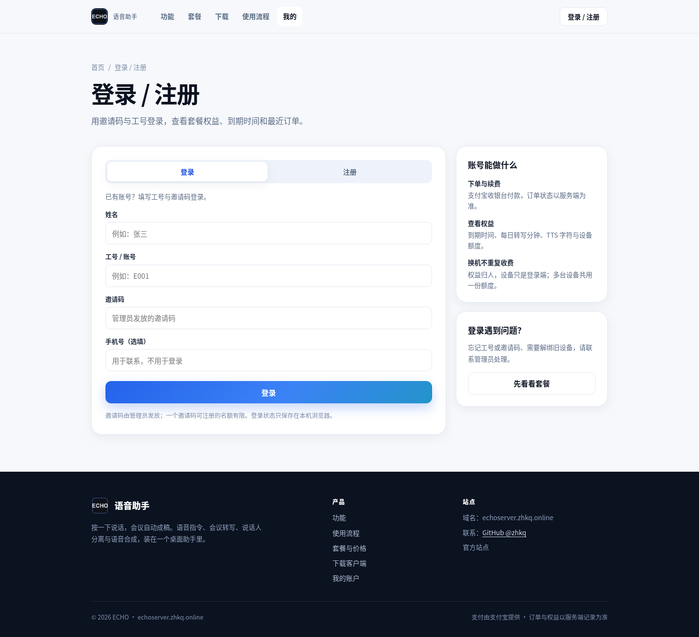
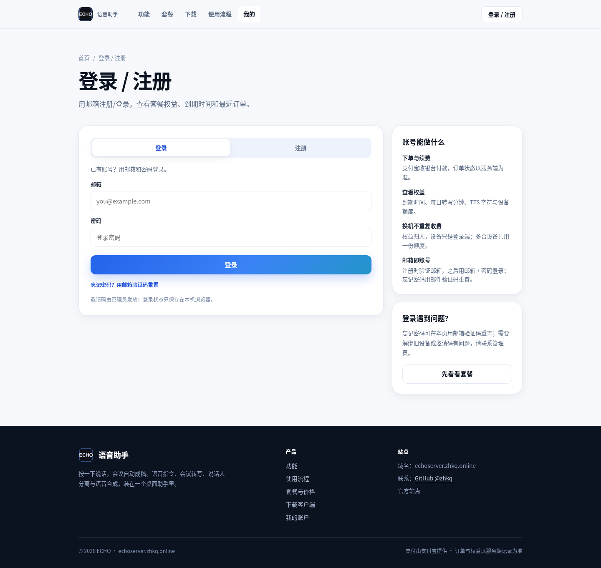
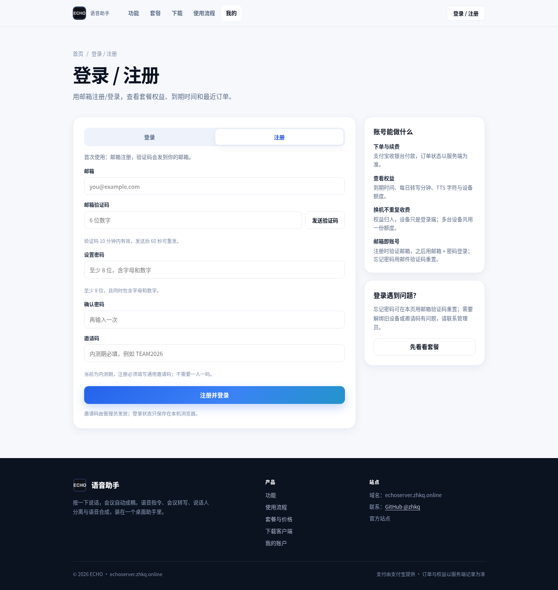
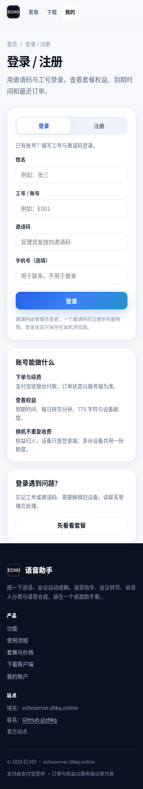
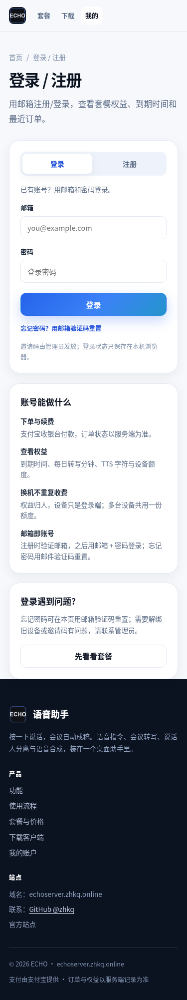
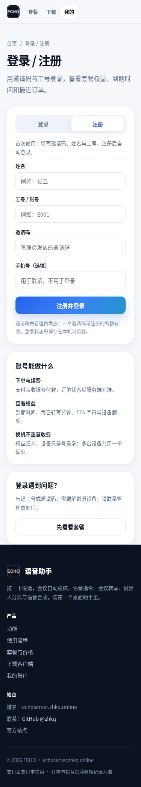
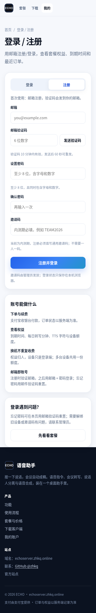
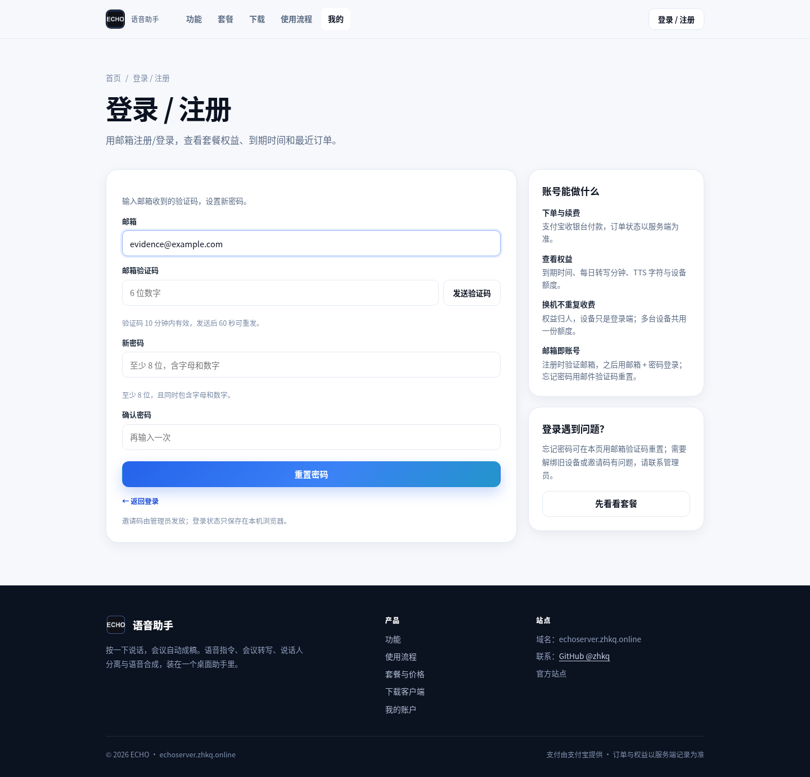
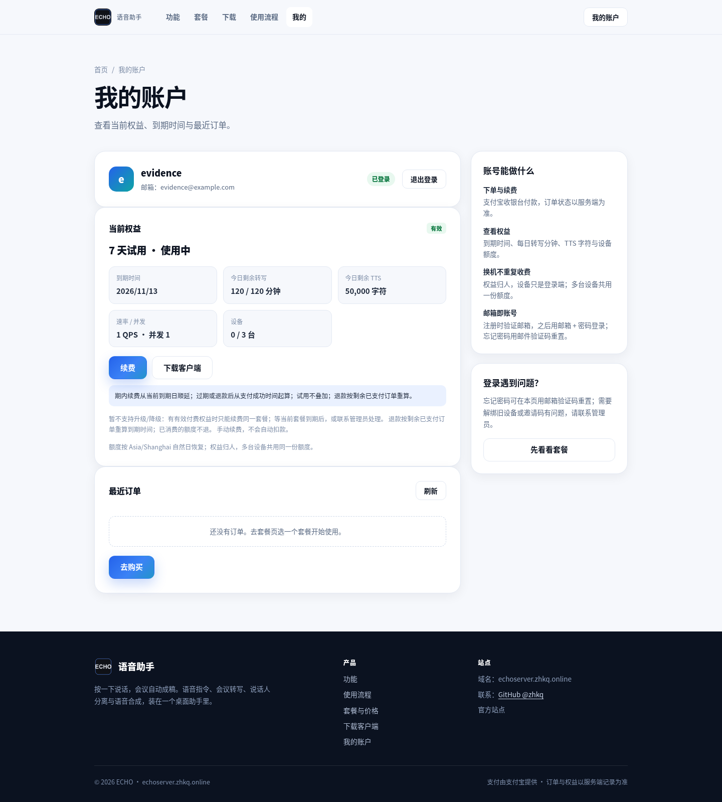

# 账号邮箱化 Before / After 截图（issue #15）

本目录是 issue #15「邮箱即账号」的视觉证据。**Before = 目标分支基线 `16d61a3` 的
`site/`**（用 `git archive` 取出后由本地静态站渲染），**After = 当前工作树 `site/`**。
两侧用同一套静态站、同一视口、浅色、中文：

- 桌面：1440 × 900
- 移动：375 × 812

After 用**真实** `server.main`（临时 `auth.db`、`account.email.provider=dev`、
`billing` mock、`invite.required=true`、通用邀请码 `TEAM2026`）走了一遍
「登录 → 注册（真实发码 / 校验码）→ 登出 → 忘记密码 → 重置 → 新密码登录」；
验证码从临时后端日志读取（`[account.email][dev]`），**没有发真实邮件**，也没有真实支付。
Before 基线是实际旧页面，不是画出来的 mockup。

## 登录（桌面）

| Before（`16d61a3`） | After（本分支） |
|---|---|
|  |  |

## 注册（桌面）

| Before（`16d61a3`） | After（本分支） |
|---|---|
|  |  |

## 登录（移动）

| Before（`16d61a3`） | After（本分支） |
|---|---|
|  |  |

## 注册（移动）

| Before（`16d61a3`） | After（本分支） |
|---|---|
|  |  |

## After 补充：忘记密码 / 登录后账户页

Before 没有「忘记密码」入口，基线账户页的登录态展示也不是本 ticket 的改动重点，
所以下面两张是 **After 单侧补充**（不作为 Before/After 对照）：

- 忘记密码（真实发 `purpose=reset` 的码，重置成功后用新密码登录）：
  
- 注册后（7 天试用；身份行显示邮箱）：
  
- 重置后重新登录成功：
  

## 复现

```bash
# 依赖：Python + playwright + 本机 Chrome
python scripts/capture-account-email-evidence.py
# 产物：本目录 *.png + capture.json
```

基线固定为 `16d61a3`（目标分支 `integration/billing-vibepay` 在 ticket 开始时的 tip）。
如果目标分支继续前进且账户页在基线上又变了，应以新的基线重新采集；本次证据的
`capture.json` 记录了时间、基线 ref、视口与测试数据（`example.com` 保留域）。
