# 管理面重设计 · 设计稿（issue #16）

> 目标分支 `integration/billing-vibepay`。设计已确认；`server/admin.html` / `server/admin.py`
> 正在按本说明实现（见实现 PR）。静态稿仍保留，用于对照设计意图。

- [设计说明（信息架构 / 页面 / 后端改动 / 测试与证据）](./01-设计说明.md)
- [静态设计稿（可直接用浏览器打开，hash 切页）](./mockup.html)
- [Before / After 实机截图](./evidence/README.md)
- 截图脚本：`python docs/admin-redesign/capture-mockup.py`（Playwright + 本机 Chrome，不连后端）

## 视觉基线

与官网 `site/assets/site.css` 同一套 token：浅色 `#f6f8fc`、白卡片、蓝主色 `#2563eb`、
18px 卡片圆角、`0 6px 22px rgba(15,23,42,.06)` 阴影、系统字体栈。
管理面正文 14.5px、表格 13px、按钮 36px，比官网营销页更紧凑。

## 关键页面

### 登录（1280）

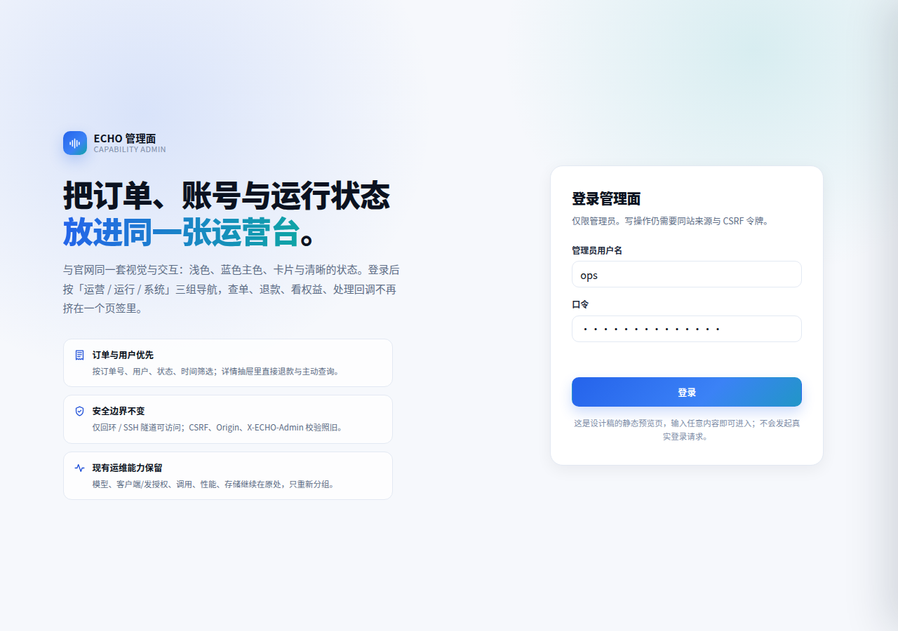

### 概览（1280）

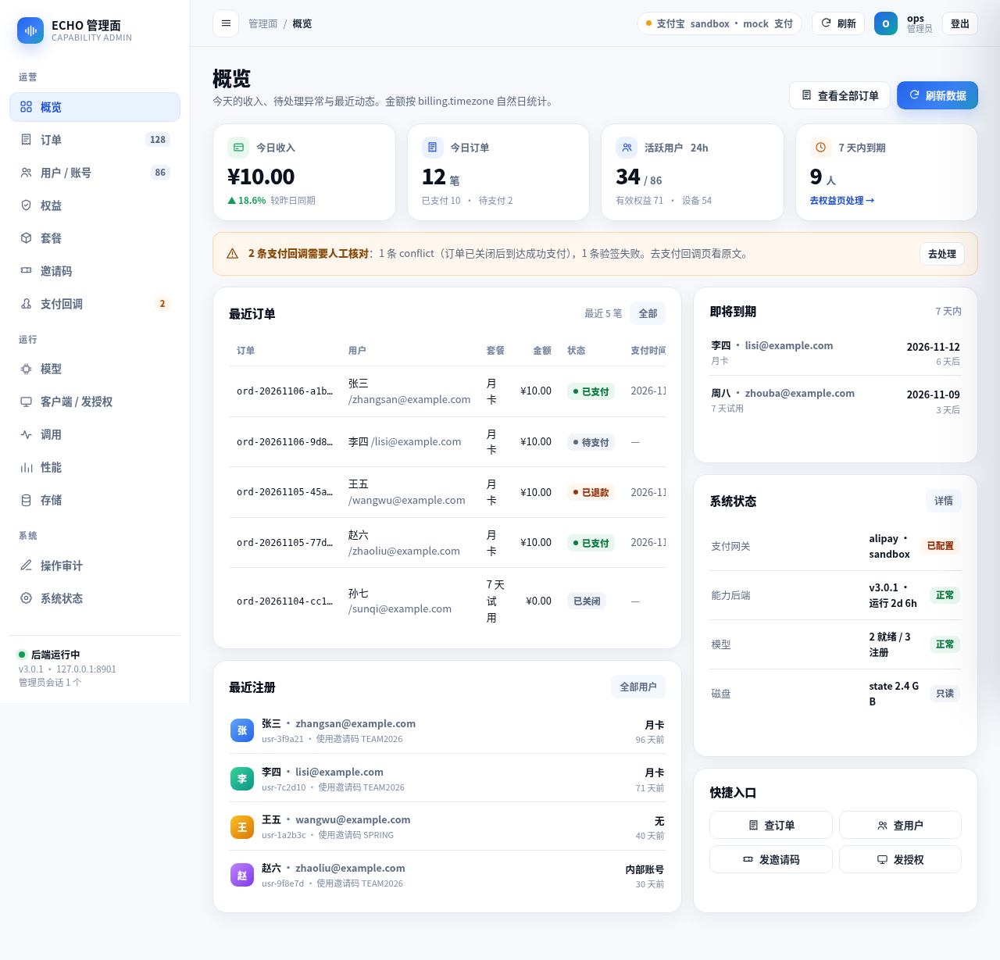

### 订单列表（1280）

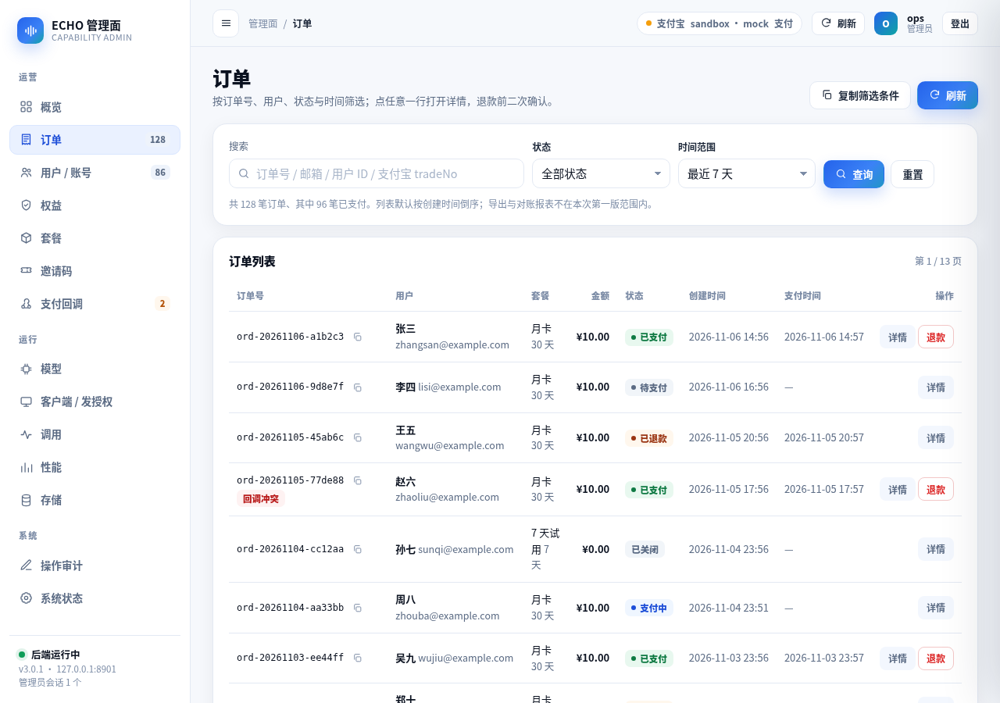

### 订单详情抽屉（1280）

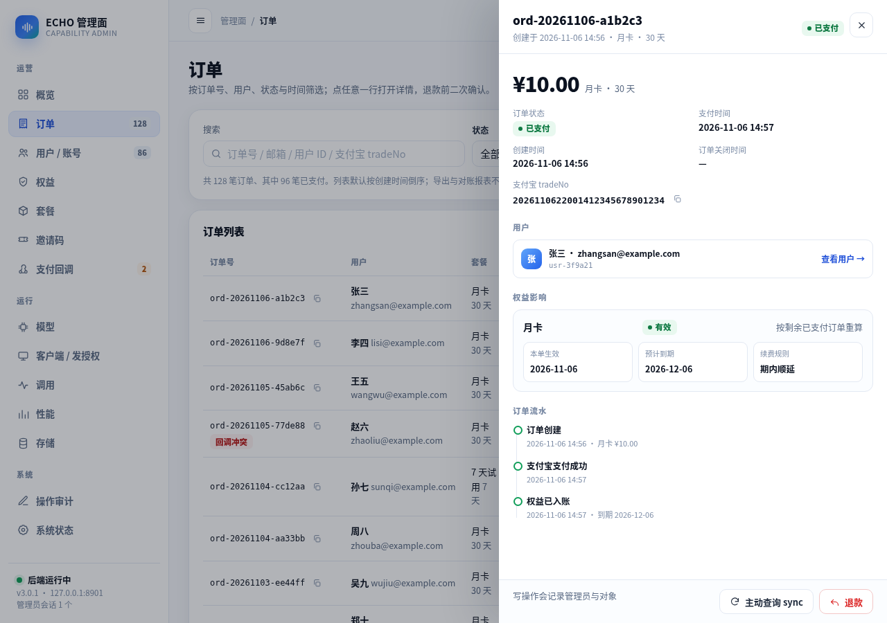

### 退款二次确认（1280）

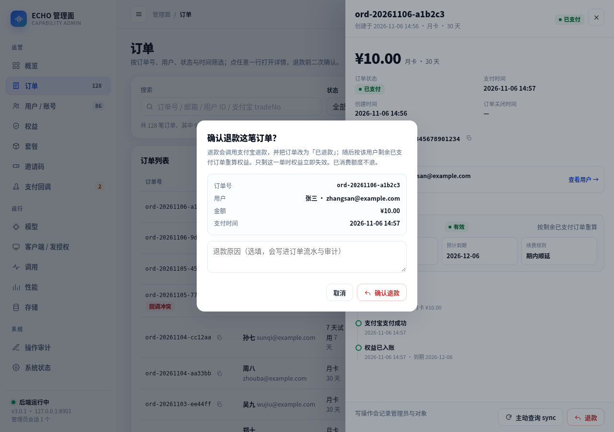

### 用户列表（1280）

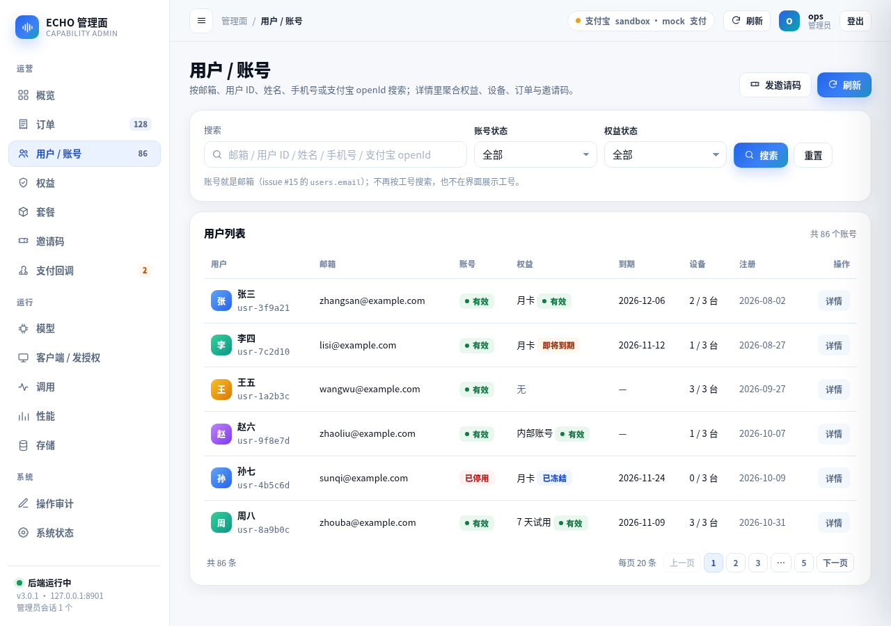

### 用户详情抽屉（1280）

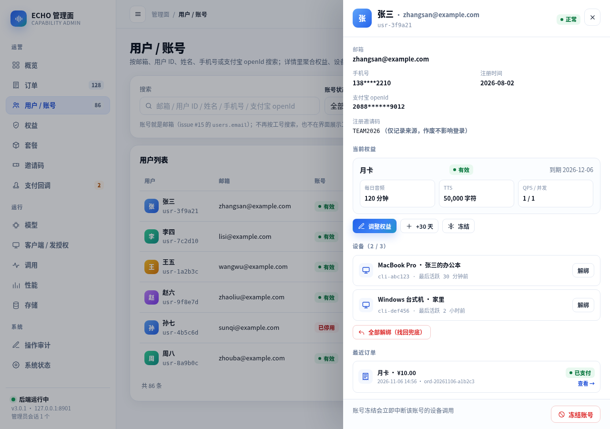

### 支付回调（1280）

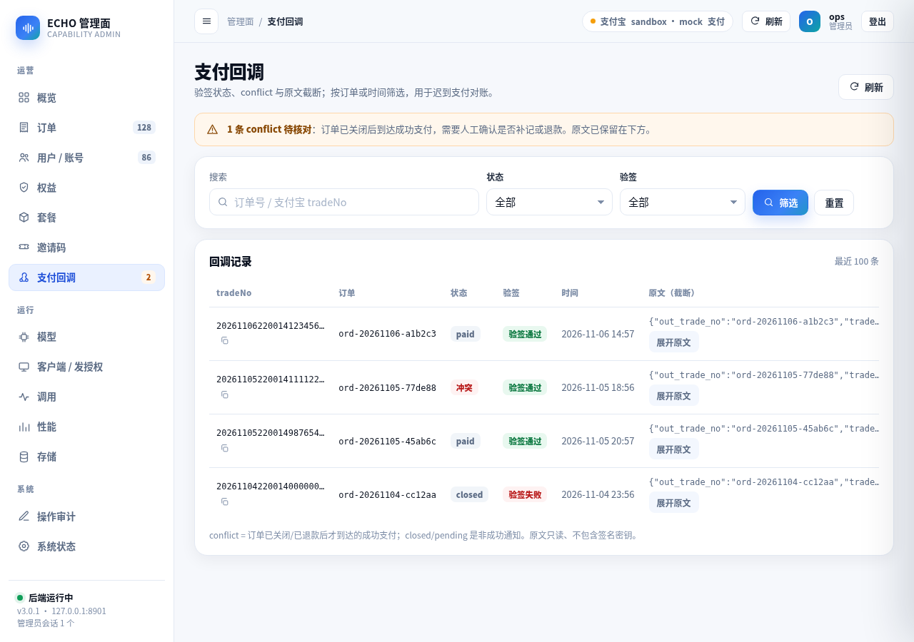

### 平板 768

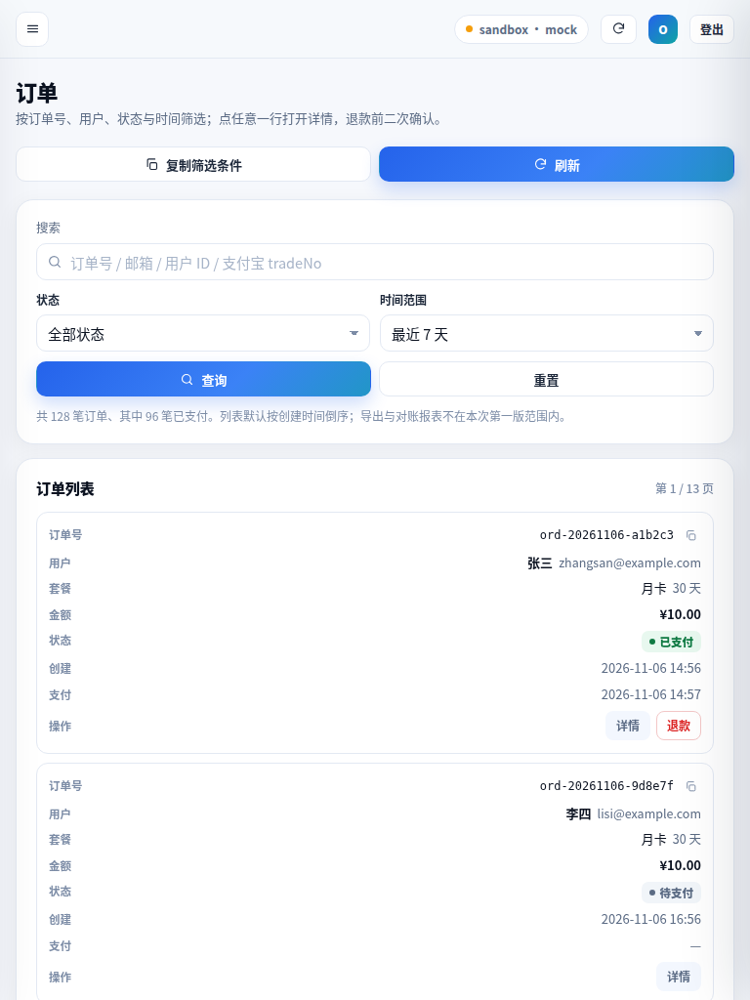

### 手机 375

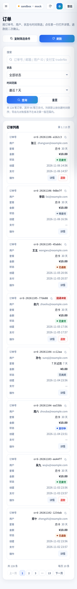

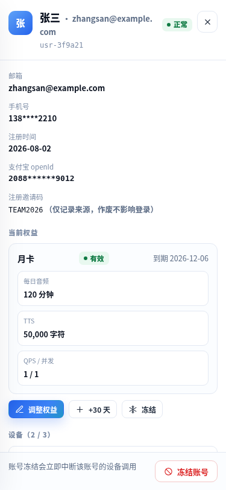

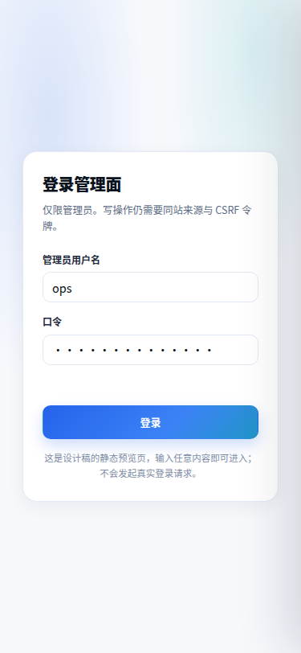

## 自检

- 14 个页面 × 1280/768/375：`document.scrollWidth == clientWidth`（无横向溢出）。
- 无 `console.error` / `pageerror`。
- 页面不引用任何外部 CDN / 框架 / 字体 / 图标 sprite；图标内联 SVG。
- 截图数据全部为示例假数据，不含真实姓名、口令或凭据。

完整清单见 [capture.json](./capture.json)。实机 Before/After 截图见
[evidence/README.md](./evidence/README.md)。
