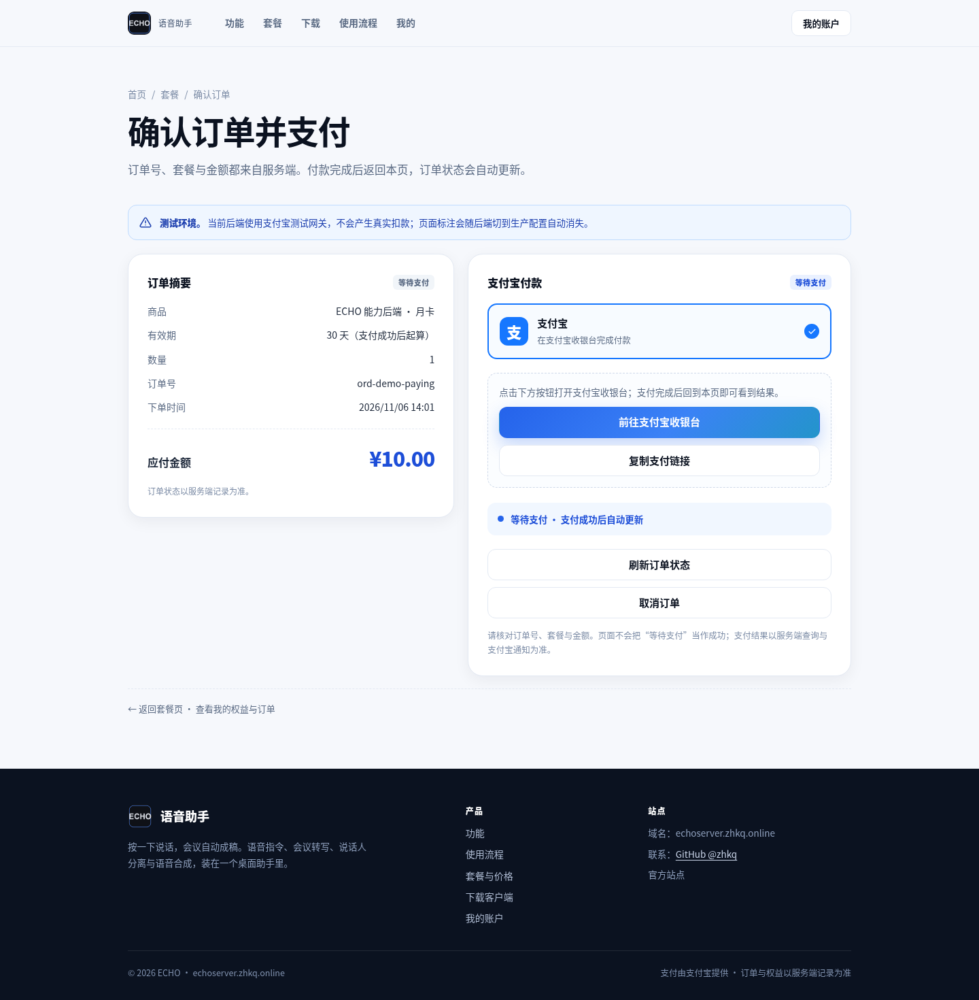
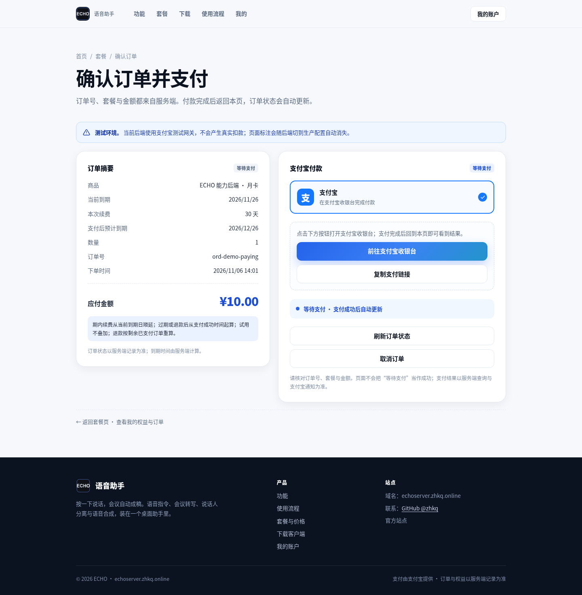
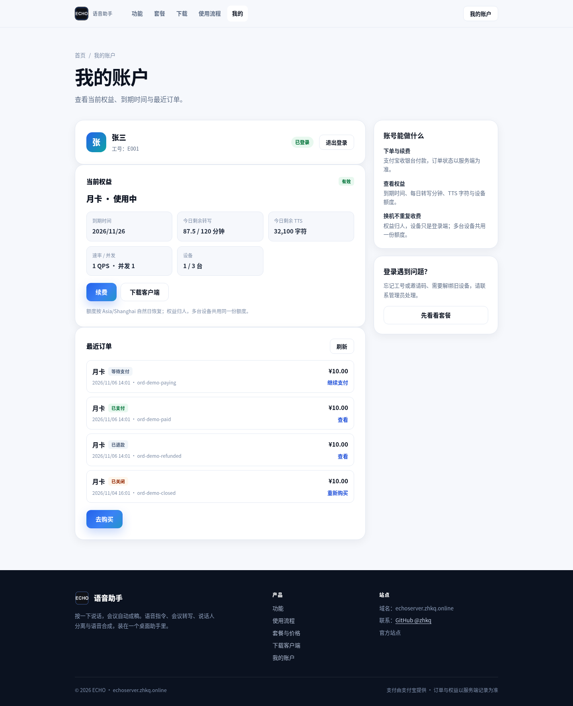
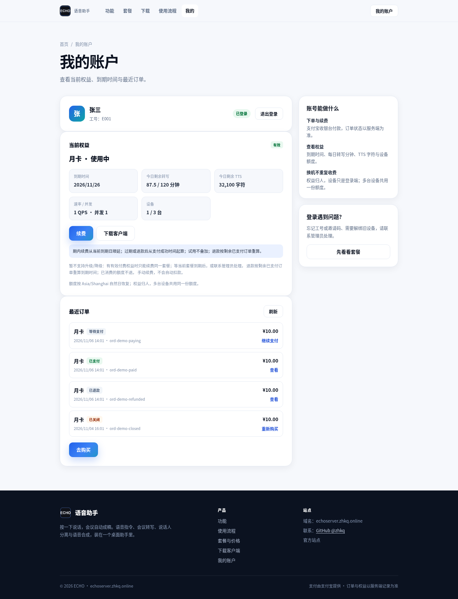
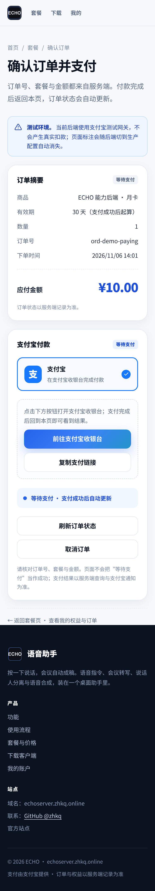
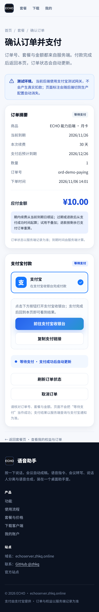
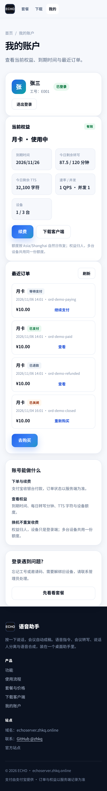
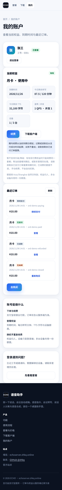

# 续费规则 / 预计到期 · Before/After 截图

对应 issue #13。目标分支 `integration/billing-vibepay`（不合 main）。

- **Before**：`2d07bc3`（本 ticket 的分支基线；账号页与支付页来自 PR #12，
  支付前不显示“当前到期 / 本次续费 / 支付后预计到期”，权益卡也没有续费规则）。
- **After**：本分支 head（服务端下发 `currentPaidUntil / renewalDays /
  projectedPaidUntil / renewalRule / planChangeRule / refundRule`，页面只负责显示）。
- 同一份 mock 订单/权益数据、同一视口（桌面 1440×900，移动 375×812）、浅色、中文；
  没有真实扣款，也不冒充支付宝沙箱真机付款。

## 桌面

| 场景 | Before（`2d07bc3`） | After（本分支） |
|---|---|---|
| 支付页（等待支付） |  |  |
| 我的账户 · 权益卡 |  |  |

After 的支付页新增：

- **当前到期**（`currentPaidUntil`，服务端给）
- **本次续费**（`renewalDays`，服务端从 `plans.days` 给）
- **支付后预计到期**（`projectedPaidUntil`，与真正入账共用同一个纯函数）
- 一句 **续费规则**（`renewalRule`，服务端下发，页面不自己写“支付成功后起算”）

After 的权益卡新增服务端下发的三句规则：续费顺延/过期起算、暂不支持升级降级、
退款按剩余已支付订单重算；自动续费显示“手动续费，不会自动扣款”。

## 移动

| 场景 | Before | After |
|---|---|---|
| 支付页 |  |  |
| 权益卡 |  |  |

## 订单状态

账户页最近订单在 Before/After 都显示全部状态（待支付 / 已支付 / 已退款 / 已关闭）；
这正是 issue 要求“不只显示 paid”的落点。After 另附一张已退款订单详情：
[after-refunded-order.png](after-refunded-order.png)。

## 限制

- 本目录是 **mock API** 截图，订单/权益不是真实扣款数据。
- 真实支付宝沙箱付款（10.00 元）由 Lead 在 2026-11-05 用沙箱 app 实测；
  本 ticket 没有重跑真实扣款，也不把 mock 截图当作真机付款证据。
- 复采：`python scripts/capture-renewal-evidence.py`。
