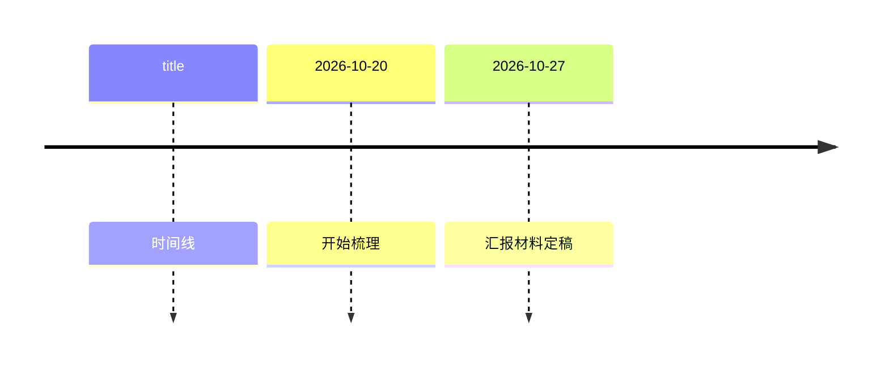

# 图表样例（2026-10-19 真事故的形状）

下面这块 gantt 是 2026-10-19 那一场真纪要里**原样**出现在面板上的形状：
`gantt` + `title: 文本`（带冒号）。它**能过 `mermaid.parse()`**，但真渲染时
`compileTask` 读 `undefined.endTime` 抛 TypeError，整张图变成 `Syntax error in text`。

```mermaid
gantt
    title: 后续工作安排（2026年10月—11月）
    dateFormat YYYY-MM-DD
    axisFormat %m.%d
    section 梳理与成图
    整理会议结论与模板 :a1, 2026-10-20, 2d
    section 汇报
    10月底汇报材料定稿 :b1, 2026-10-27, 4d
```

timeline 相反 —— 它的标题**必须**带冒号（这块不能被"顺手统一"改掉）：


